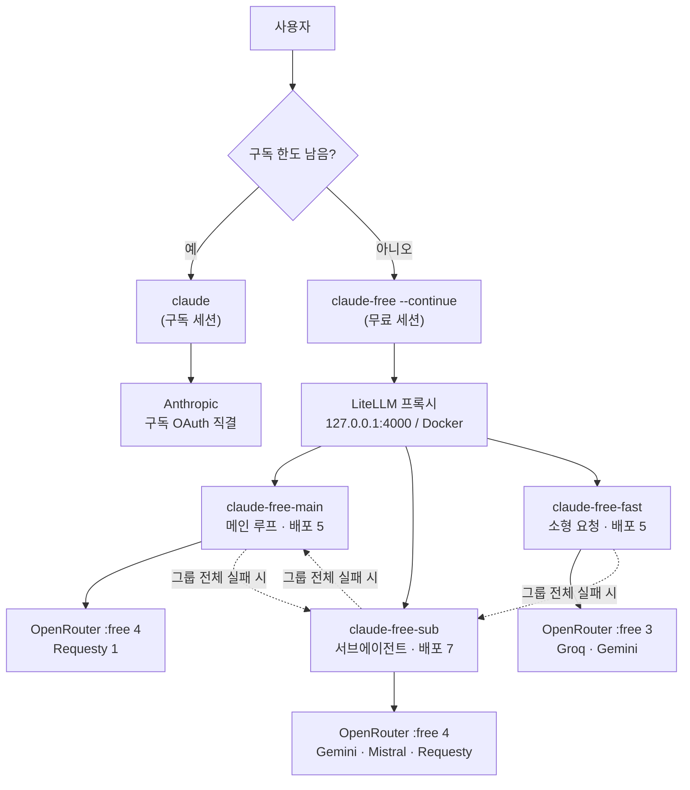
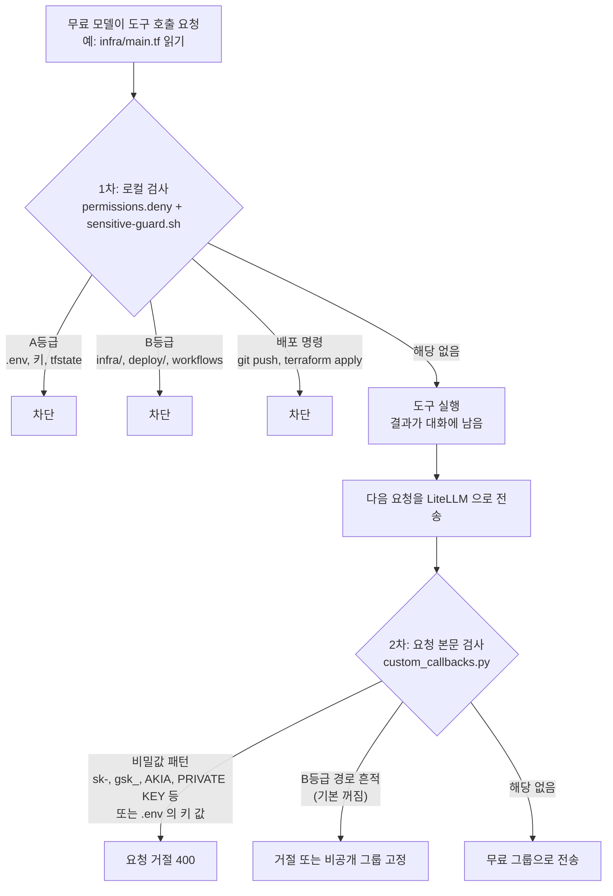

# free-model-settings

Claude Code 구독 한도가 끝났을 때 무료 모델로 작업을 이어가는 설정 모음.
명령 하나로 세션을 바꾸고, 민감한 파일은 무료 제공처로 나가지 않게 막는다.

```
claude          # 평소: 구독으로 Anthropic 직결
claude-free     # 한도 소진 후: 무료 모델로 같은 대화를 이어감
```

- 무료 제공처 5곳의 모델 17개 배포를 세 그룹으로 묶어 돌려 쓴다. 하나가 죽어도 작업이 끊기지 않는다.
- `.env`, `infra/`, `deploy/` 같은 경로는 읽기 전에 막는다.
- 무료 세션에서는 `git push`, `terraform apply` 같은 배포 명령을 막는다.

---

## 구조



그룹 안에서는 `rpm`을 가중치로 무작위 분산한다. 한 모델이 429나 503을 주면 60초간 빼고 같은 그룹의 다른 모델로 재시도한다. 그룹 전체가 막히면 다른 그룹으로 넘어간다. Claude Code는 이 과정을 모르고 응답만 받는다.

| 그룹 | 연결되는 곳 | 기준 |
|---|---|---|
| `claude-free-main` | 메인 모델, `opus`/`sonnet`/`fable` alias | 컨텍스트 큰 모델 |
| `claude-free-sub` | `CLAUDE_CODE_SUBAGENT_MODEL` | 서브에이전트 |
| `claude-free-fast` | `haiku` alias | 제목 생성·요약 등 소형 요청 |

---

## 민감 정보 보호

판별은 모두 코드(정규식)로 한다. 모델을 호출하지 않는다.



2차가 필요한 이유: 1차는 도구 호출의 경로만 본다. `cat` 출력, MCP 응답, 이어받은 이전 대화는 1차를 지나간다.

2차는 두 가지를 본다. 접두어가 정해진 키(OpenAI·Anthropic `sk-`, Groq `gsk_`, GitHub `ghp_`·`github_pat_`, GitLab, Google `AIza`, AWS `AKIA`·`ASIA`, Stripe `sk_live_`, Slack, Hugging Face, npm, 개인 키 헤더)와, 이 저장소 `.env`에 든 키 값 자체다. 뒤쪽 덕분에 Mistral처럼 접두어가 없는 키도 잡힌다. JWT는 Supabase anon 키 같은 공개용 값과 구분할 수 없어 넣지 않았다.

B등급 경로 검사는 기본으로 꺼져 있다. 경로 "언급"만으로 막기 때문에, `infra/` 폴더가 있는 프로젝트는 Claude Code가 시스템 프롬프트에 넣는 파일 목록 탓에 모든 요청이 막힌다. 켜려면 `docker-compose.yml`의 `GUARD_BLOCK_B_PATHS`를 `1`로 둔다.

| 등급 | 규칙 | 대상 |
|---|---|---|
| A | 어떤 모델에도 보내지 않음 | `.env*`, 키·인증서, `*.tfstate`, `*.tfvars`, `~/.ssh`, `~/.aws`, `~/.kube`, `secrets/` |
| B | 학습·로깅하는 무료 제공처에 보내지 않음 | `infra/`, `deploy/`, `terraform/`, `k8s/`, `helm/`, `.github/workflows/`, `docker-compose*` |
| C | 제한 없음 | 나머지 코드 |

프로젝트별 패턴은 그 프로젝트의 `.claude/sensitive-paths.txt`에 한 줄씩 추가한다.
저장소 전체를 금지하려면 그 저장소에 `.claude/private-repo` 파일을 만든다.

---

## 설치

필요한 것: Docker, `jq`, Claude Code, zsh.

```bash
git clone <이 저장소> && cd free-model-settings
cp .env.example .env && chmod 600 .env
echo "sk-$(openssl rand -hex 24)"     # 출력값을 .env 의 LITELLM_MASTER_KEY 에 적는다
```

`.env`에 OpenRouter 키를 넣는다. [openrouter.ai](https://openrouter.ai)에서 발급하고, 하루 1,000건을 쓰려면 $10을 한 번 충전한다(충전하지 않으면 하루 50건).

```bash
docker compose up -d
echo "source $PWD/shell/claude-free.zsh" >> ~/.zshrc
source ~/.zshrc
```

확인:

```bash
claude-free -p "Reply with exactly: OK"
```

---

## 사용

| 상황 | 명령 |
|---|---|
| 평소 | `claude` |
| 한도 소진 후 이어가기 | `claude-free --continue` |
| 무료 세션 새로 시작 | `claude-free` |
| LiteLLM 상태 | `curl -s localhost:4000/health/liveliness` |
| 무료 모델 상태 확인 | `curl -s localhost:4000/health -H "Authorization: Bearer $LITELLM_MASTER_KEY"` |

구독 세션에서 `.env`나 `infra/`를 다뤘다면 `--continue`를 쓰지 않는다. 이전 대화 전체가 무료 제공처로 전송된다.

LiteLLM은 `restart: unless-stopped`라 컴퓨터를 재시작해도 자동으로 올라온다.

---

## 파일

| 파일 | 역할 |
|---|---|
| `config.yaml` | LiteLLM 모델 그룹, 분산, fallback |
| `docker-compose.yml` | LiteLLM v1.101.0 (digest 고정), 127.0.0.1 만 개방 |
| `shell/claude-free.zsh` | `claude-free` 함수 |
| `claude/free-session.settings.template.json` | 무료 세션 차단 규칙과 hook 연결 |
| `hooks/sensitive-guard.sh` | 경로 판별 |
| `litellm/custom_callbacks.py` | 요청 본문 검사. 비밀값 패턴·`.env` 키 값 차단 (켜짐), B등급 경로 차단 (꺼짐) |
| `scripts/check-models.sh` | 등록 모델이 아직 무료·도구 호출 가능한지 점검 |
| `DESIGN.md` | 전체 설계, 검증 기록 |
| `SENSITIVE.md` | 민감 정보 보호 설계 |
| `OVERVIEW.md` | 도표 요약 |
| `research/` | 제공처·라우터 조사 원문 |

---

## 제공처

`.env`에 키를 넣고 `config.yaml`의 해당 항목 주석을 풀면 한도가 합쳐진다.

| 제공처 | 무료 한도 | 상태 |
|---|---|---|
| OpenRouter | 20 RPM / 1,000 RPD ($10 1회 충전 시. 미충전 50 RPD) | 사용 중 (main·sub·fast) |
| Requesty | 200 RPD. 가격 0 NVIDIA 모델만 등록 | 사용 중 (main·sub). 입력 학습 활용 |
| Gemini | Flash-Lite 약 500 RPD | 사용 중 (sub·fast). 입력 학습 활용 |
| Mistral | 1 RPS, 월 4M~10M 토큰. 전화 인증 필요 | 사용 중 (sub). 학습 활용 기본값, 콘솔에서 끌 수 있음 |
| Groq | 30 RPM / 1K RPD / 8K TPM | 사용 중 (fast 전용, 입력 6K 토큰 이하만) |
| NVIDIA NIM | 40 RPM | 보류. 2026-09 신규 계정 수동 인증 대기 |

OpenRouter 한도 등급은 **누적 구매액** 기준이라 한 번 충전하면 잔액이 줄어도 유지된다. `:free` 모델만 쓰면 잔액이 줄지 않는다. 잔액이 음수면 `:free`도 402로 거절되니 `:free` 모델만 등록한다.

### 등록된 모델 (2026-09-26)

| 제공처 | 모델 | 컨텍스트 | 그룹 |
|---|---|---|---|
| OpenRouter | `nvidia/nemotron-3-ultra-550b-a55b:free` | 1M | main |
| OpenRouter | `nvidia/nemotron-3-super-120b-a12b:free` | 262K | main |
| OpenRouter | `nvidia/nemotron-3.5-lightning:free` | 1M | main, fast |
| OpenRouter | `qwen/qwen3.8-27b:free` | 262K | main, fast |
| OpenRouter | `cohere/north-mini-code:free` | 256K | sub |
| OpenRouter | `poolside/laguna-xs-2.1:free` | 262K | sub, fast |
| OpenRouter | `google/gemma-4-31b-it:free` | 262K | sub |
| OpenRouter | `nvidia/nemotron-3-nano-omni-30b-a3b-reasoning:free` | 256K | sub |
| Requesty | `nvidia/nemotron-3-ultra-550b-a55b` | 1M | main |
| Requesty | `nvidia/nemotron-3-super-120b-a12b` | 1M | sub |
| Gemini | `gemini-3.5-flash-lite` | - | sub, fast |
| Mistral | `codestral-2508` | 256K | sub |
| Groq | `openai/gpt-oss-120b` | 131K (입력 6K 제한) | fast |

2026-09-22에 넣은 `nex-n2.5-pro`, `nex-n2.5-mini`, `ling-3.0-flash-vl`은 나흘 만에 무료 목록에서 빠져 교체했다. 무료 모델 목록은 자주 바뀌니 가끔 점검한다.

```bash
scripts/check-models.sh               # 등록 모델이 아직 무료·도구 호출 가능한지. 문제 있으면 종료 코드 1
scripts/check-models.sh --candidates  # 등록되지 않은 OpenRouter 무료 도구 호출 모델도 출력
```

`config.yaml`을 고친 뒤에는 `docker compose restart`로 반영한다.

---

## 한계

- **공식 비지원**: Anthropic은 게이트웨이를 통한 비-Claude 모델 연결을 지원하지 않는다. 동작은 하지만 품질과 호환성은 보장되지 않는다.
- **자동 전환 없음**: 구독 한도가 끝나면 직접 `claude-free --continue`를 실행해야 한다. 의도한 설계다.
- **서버 도구 없음**: WebSearch 등 Anthropic 서버 도구는 동작하지 않는다.
- **prompt caching 없음**: 요청마다 전체 토큰을 쓴다.
- **도구 호출 품질**: 무료 모델은 도구 호출을 누락하는 경우가 있다.
- **데이터 학습**: Gemini 무료분, Mistral 기본값, Requesty의 NVIDIA 무료 모델은 입력을 학습에 쓴다. 민감한 작업에는 `config.yaml`에서 해당 항목을 주석 처리하거나 구독 세션을 쓴다.
- **차단 범위**: 목록에 있는 패턴만 잡는다. 이름이 평범한 민감 파일은 지나간다.

---

## 확인된 것과 남은 것

| 항목 | 상태 |
|---|---|
| LiteLLM 기동, 세 그룹 응답 | 확인 |
| 무료 모델 도구 호출 | 확인 (8개) |
| 모델 장애 시 다른 모델로 전환 | 확인 |
| `.env` 차단 (읽기 + `cat` 우회) | 확인 |
| 구독 세션 → 무료 세션 `--continue` | 확인. 이전 대화 내용이 이어짐 |
| `haiku` alias → `claude-free-fast` | 확인. 배경 요청이 fast 그룹으로 감 |
| 요청 본문 검사 (`custom_callbacks.py`) | 확인. 비밀값 패턴 400 차단 |
| 서브에이전트 → `claude-free-sub` | 확인. 단 `CLAUDE_CODE_SUBAGENT_MODEL_FORCE=1` 이 필요하다 (아래) |
| Gemini·Groq·Mistral·Requesty 추가 후 세 그룹 도구 호출 | 확인 (2026-09-26, `/v1/messages`) |
| Groq 형식 키, `.env` 키 값 차단 | 확인 (2026-09-26). 400 거절 |

`CLAUDE_CODE_SUBAGENT_MODEL` 만 두면 서브에이전트가 `claude-free-main` 으로 간다. 내장 에이전트 정의의 `model: inherit` 이 환경변수보다 우선하기 때문이다. `CLAUDE_CODE_SUBAGENT_MODEL_FORCE=1` 을 같이 주면 sub 그룹으로 간다. `claude-free` 함수에 이미 들어 있다.

---

## 라이선스

MIT

## CloudCLI 웹 UI

공식 Claude Agent SDK로 기존 Claude Code 대화를 이어간다. 홈 디렉터리 기준으로 설치하므로
이 저장소 밖의 어느 폴더에서든 사용할 수 있다. Node.js 22 이상이 필요하다.

```bash
scripts/install-cloudcli.sh    # 홈 디렉터리에 최초 설치 또는 실행기 갱신
claude-cloud                  # 자동: 계정 1 → 크레딧 소진 시 계정 2 (3001)
claude-cloud --account 1      # 계정 1 고정 (3001)
claude-cloud --account 2      # 계정 2 고정 (3002)
claude-cloud --reset-accounts # 자동 모드의 시작 계정을 1로 초기화
```

`~/.config/claude-cloud/keys.env`에 다음을 넣는다 (파일 권한 600).

```dotenv
ANTHROPIC_1_API_KEY=첫번째키
ANTHROPIC_2_API_KEY=두번째키
```

실행기는 `~/.local/bin/claude-cloud`, 설치 패키지·로그인 DB는
`~/.local/share/claude-cloud/`에 있다. 기본 포트는 3001이며 `http://127.0.0.1:3001`을 연다.
처음 접속할 때 만드는 로컬 로그인은 Anthropic 로그인과 별개다. 자동 모드와 계정 1 고정은
같은 로컬 로그인 DB를 쓰며, 계정 2 고정은 별도 DB를 쓴다. 기존 `~/.claude` 대화는 공통으로 검색한다.
프로젝트와 대화를 선택해 웹 채팅으로 이어간다. 내장 터미널의 일반 `claude`는 크레딧용 SDK 경로가 아니다.

자동 모드는 로컬 연결기가 SDK 요청을 Anthropic 공식 API로 전달하고, 잔액 부족 HTTP 오류를
받으면 해당 요청만 다른 키로 한 번 재시도한다. 이미 실행된 도구나 시작된 응답 스트림은
재실행하지 않는다. 두 계정 모두 소진되면 오류를 그대로 반환한다. 전환된 우선 계정을 로컬에
기록해 다음 실행에도 사용한다. 월별 크레딧이 충전되면 `--reset-accounts`로 계정 1부터 다시 시작할 수 있다.
API 오류 응답이 아닌 스트림 도중 발생한 오류에는 자동 전환하지 않는다. 인증 오류·일반적인 속도 제한·
서버 장애도 키 소진으로 판단하지 않는다. 유료 잔액이 있으면 Anthropic이 계속 그 잔액을 쓸 수 있으므로
이 기능은 월 $200 상한이나 자동 지출 차단 기능이 아니다.

계정 고정 모드는 Anthropic에 직접 연결한다. 자동 모드는 임시 로컬 인증 토큰을 사용하는
loopback 연결기를 거치며, 업스트림에는 SDK 헤더·본문을 유지하고 API 키만 바꿔 전달한다.
서버는 모두 `127.0.0.1`에만 열린다. 같은 대화에 여러 창에서 동시에 요청하지 않는다.
Ctrl+C로 서버를 종료한다. 전환 로직 검증: `node --test scripts/cloudcli-gateway.test.mjs`.
